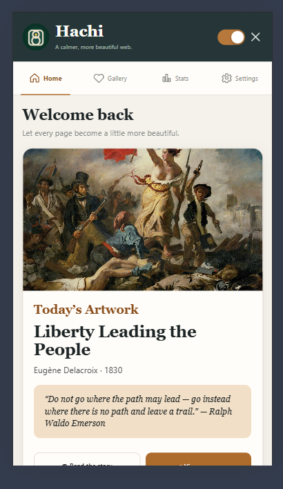
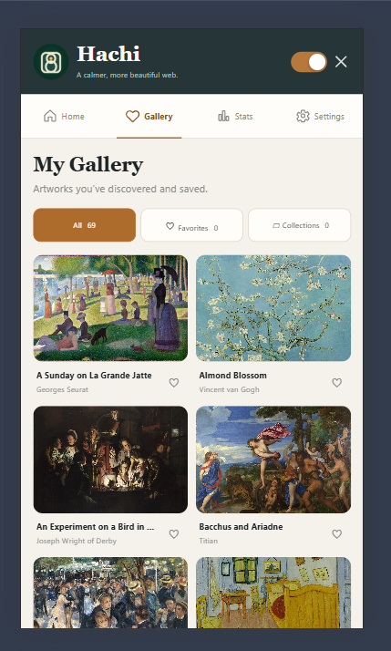
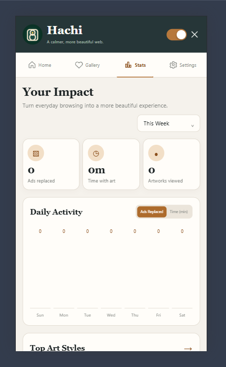
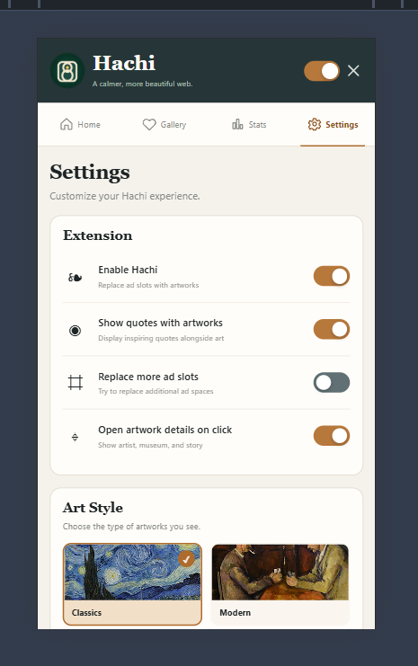

# Hachi 

Hachi is a privacy-first Chrome extension that replaces detected ad spaces with
beautiful public-domain artworks, short cultural facts, and optional quotes.
Your browser becomes a calmer, more beautiful place to read.

All settings, favorites, collections, photos, and activity data stay **local**
on your device using `chrome.storage`. There are no accounts, no Hachi-operated
servers, and no analytics. Artwork images are retrieved from Wikimedia Commons.

---

## How it works

- Hachi watches ordinary HTTP and HTTPS pages for likely advertising containers
  using ad-network signals, naming conventions, visibility, dimensions, and
  text limits.
- A valid ad slot is replaced with an isolated **Shadow DOM artwork card**, so
  page CSS cannot affect the artwork and page scripts cannot modify it.
- The original element is hidden rather than removed, allowing Hachi to restore
  the page when the extension is disabled.
- A debounced **MutationObserver** handles common late-loading ads and
  single-page-app changes.
- If an artwork image cannot load, Hachi shows a gradient museum plaque instead
  of a broken image.
- You can pause Hachi globally, disable it on the current site, choose a style,
  and browse your personal gallery.

## Getting started

1. Install Hachi from the Chrome Web Store.
2. Open the popup and leave **Enable Hachi** turned on.
3. Browse normally. When Hachi detects a valid ad slot, artwork appears in its
   place.
4. Open **Gallery** to review discovered artworks, favorites, and collections.
5. Open **Settings** to choose a style, change appearance, upload personal
   photos, or disable Hachi on the current website.
6. Use **Disable on this site** whenever a page needs to remain exactly as-is.

## Features

### 🎨 Artwork gallery

- 100 curated artworks plus 16 quote cards
- Style groups: Classics, Modern, Nature, Photography, Architecture, Dutch Golden Age, American Masters, and Travel Posters
- Offline artwork cache: viewed artworks stay available without a network connection
- Artwork cards include title, artist, year, and a short cultural fact
- A shuffled artwork deck avoids repeats until its pool is exhausted
- Artwork detail dialog with the full fact and source link

### 🖼 Personal collection

- **Favorites** — keep the artworks you love close at hand
- **Collections** — group artworks into custom collections
- **Recent discoveries** — see what you encountered recently
- **Search-free gallery browsing** — switch between All, Favorites, and
  Collections from the popup

### 📊 Stats and progress

- Daily and lifetime ad-replacement counters
- Active reading-style time with art
- Daily activity chart for ads replaced and time with art
- Art-style breakdown and top artists
- Curator milestones as your personal museum grows

### 🖼 My Photos

- Upload up to seven JPG, PNG, or WebP images
- Photos are compressed and stored locally on your device
- **Use My Photos** makes your own images replace detected ad slots
- Remove individual photos at any time

### 🔔 Appearance and sharing

- Light, Dark, and System appearance modes
- Daily featured artwork
- Weekly gallery share card generated locally as a PNG
- Per-site disable control for pages that should stay unchanged

### 🔒 Privacy first

- No accounts, tracking, analytics, or Hachi-operated backend
- Settings and activity data remain in local extension storage
- Artwork images load from Wikimedia Commons
- Remote artwork image requests use `no-referrer`
- Automatic ad detection uses conservative checks to reduce false positives

---

## Screenshots
### Home

### Gallery

### Stats

### Settings

---

## Roadmap ideas (v1.2+)

- **More artwork collections** — Dutch Golden Age, American masters, and
  vintage travel posters.
- **Offline artwork cache** — keep viewed artworks available after the first
  successful image load.
- **Milestone sharing prompts** — celebrate meaningful replacement milestones
  with the weekly share card.
- **More share-card layouts** — add social-friendly sizes and artwork filters.
- **Time-based artwork styles** — optionally switch styles by time of day or
  season.
- **Collection import and export** — move favorites and collections between
  devices.
- **Detection diagnostics** — make it easier to report and investigate false
  positives on specific sites.

---
